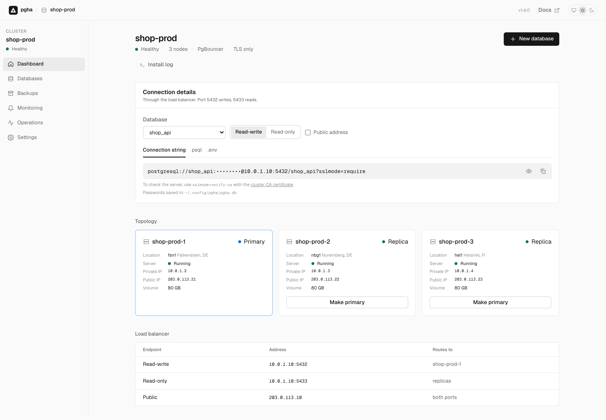
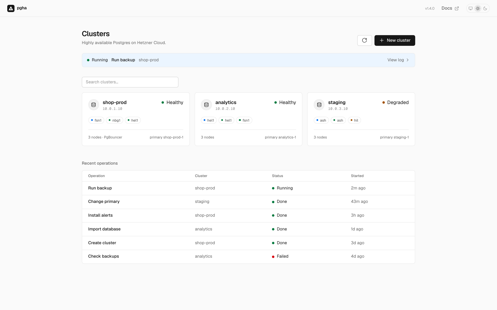
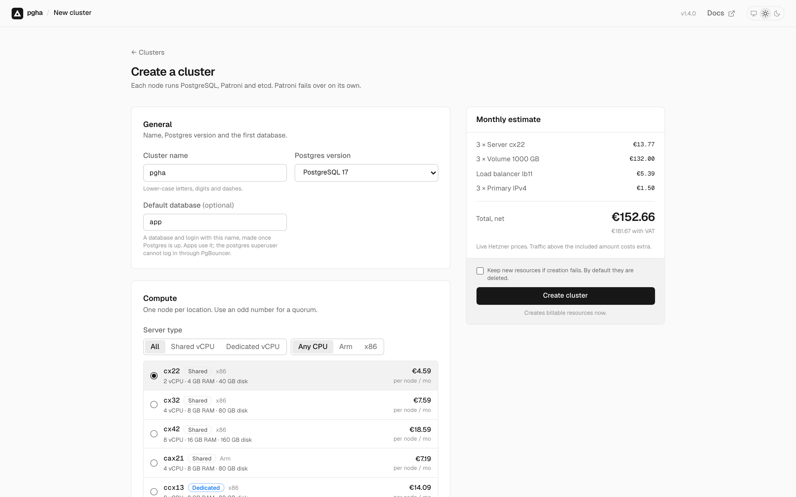
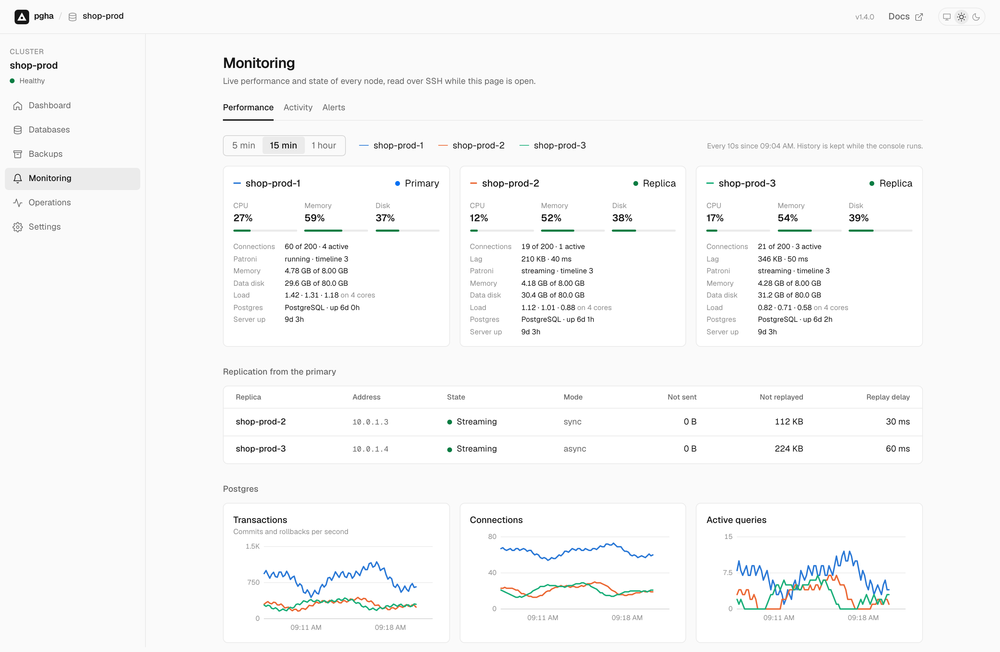
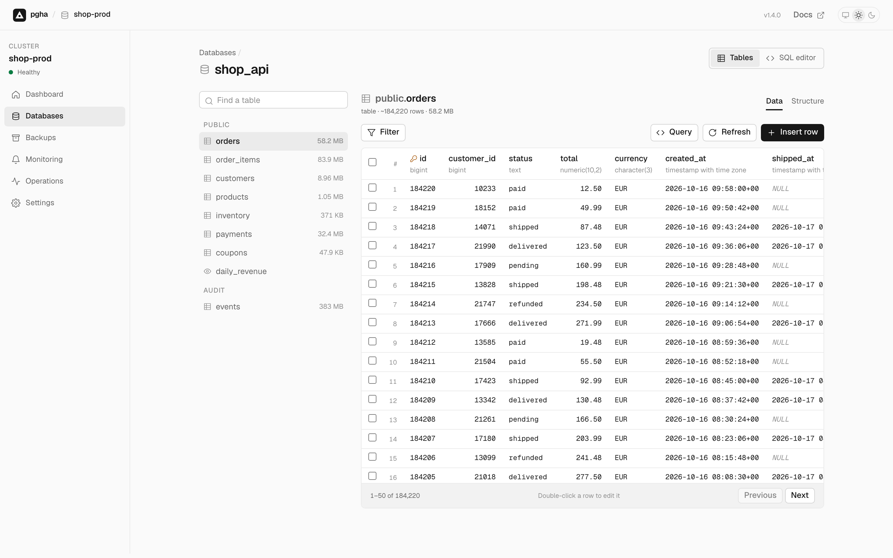

# pgha

Public releases of the pgha CLI. pgha creates a highly available PostgreSQL cluster on Hetzner Cloud.

Documentation: <https://mantissatech.github.io/pgha-cli/>

<picture>
  <source media="(prefers-color-scheme: dark)" srcset="docs/screenshots/dashboard-dark.png">
  
</picture>

## Install

macOS and Linux:

```bash
curl -fsSL https://github.com/mantissatech/pgha-cli/releases/latest/download/install.sh | sh
```

Homebrew, on macOS and Linux:

```bash
brew install mantissatech/tap/pgha
```

Docker, on Linux amd64 and arm64. The image has the CLI and the web console:

```bash
docker run -d --name pgha -p 127.0.0.1:7070:7070 \
  -v pgha-data:/data -e HCLOUD_TOKEN ghcr.io/mantissatech/pgha-cli:latest
docker logs pgha    # the console sign-in link
```

See [Container image](https://mantissatech.github.io/pgha-cli/docs/container-image/) and [Run the console on a server](https://mantissatech.github.io/pgha-cli/docs/run-the-console-on-a-server/). The `Container image` workflow builds it from the release binaries when a release is published.

Ubuntu, Debian, Fedora, and Windows packages are attached to each [release](https://github.com/mantissatech/pgha-cli/releases). The [install page](https://mantissatech.github.io/pgha-cli/install/) has the apt, yum and Scoop commands.

## Web console

`pgha console` does the same in a browser: create clusters with the live bill, manage databases, browse and edit tables, run SQL, and watch every node.

| | |
|---|---|
| <picture><source media="(prefers-color-scheme: dark)" srcset="docs/screenshots/clusters-dark.png"></picture> | <picture><source media="(prefers-color-scheme: dark)" srcset="docs/screenshots/new-cluster-dark.png"></picture> |
| Clusters and recent operations | New cluster, with the monthly bill |
| <picture><source media="(prefers-color-scheme: dark)" srcset="docs/screenshots/monitoring-dark.png"></picture> | <picture><source media="(prefers-color-scheme: dark)" srcset="docs/screenshots/table-explorer-dark.png"></picture> |
| Live charts and replication | Browse and edit rows |

Read [`pgha console`](https://mantissatech.github.io/pgha-cli/docs/command-reference/#811-pgha-console) in the documentation.

The `gh-pages` branch holds the documentation site and the apt and yum repositories. Both are generated; do not edit the branch by hand.
